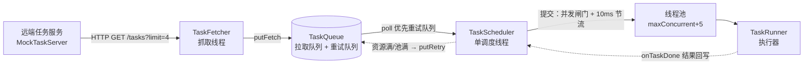

# 生产-消费并发执行框架（concurrent 模块）

一个典型的生产-消费并发执行框架：远端服务**持续产生任务**，本地以"抓取线程 + 双队列 + 单调度线程 + 线程池"的流水线并发消费。适用于**执行受稀缺资源限制**的场景——资源被占用时不阻塞等待，而是 50ms 内快速失败返回错误码 `42901`，失败任务回退重试队列不丢失；同时用本地缓冲与拉空抑制控制对上游服务的请求压力。

- 源码包：`com.yzl.consume`，Java 8 源码级别
- 测试：13 个用例（单元 + 端到端），`mvn -pl concurrent test`

## 场景与目标

1. 远端任务由服务端持续产生，通过 HTTP 批量拉取，本地队列预取缓冲
2. 执行受资源池限制（示例中为并发闸门 + 20% 随机资源满），槽位不足时任务**快速失败而非排队阻塞**
3. 快速失败（`ERROR_RESOURCE_FULL=42901`，50ms 内返回）的任务放回**重试队列**优先重试，任务不丢失
4. 抑制对上游的请求压力：拉空后不主动轮询（只等 10s 超时兜底），队列满时暂停抓取
5. 提交节流，避免瞬时提交导致的快速失败风暴

## 架构总览



数据流（不依赖图表渲染）：远端 → `TaskFetcher` 批量拉取 `putFetch` → `TaskQueue`；`TaskScheduler` 出队后按闸门提交线程池，`TaskRunner` 执行；结果经 `onTaskDone` 回写；资源满快速失败的任务经 `putRetry` 回退重试队列。

线程模型（全部守护线程）：

| 线程 | 数量 | 职责 |
| --- | --- | --- |
| `task-fetcher` | 1 | 批量拉取远端任务放入拉取队列；拉空抑制、10s 兜底 |
| `task-scheduler` | 1 | 取任务、闸门检查、节流提交；失败回退重试队列并暂停等待 |
| `task-pool-N` | `maxConcurrent+5` | 执行任务（core=min(8,N)，`SynchronousQueue` 无缓冲，`AbortPolicy`） |
| `mock-task-server-N` | 2 | mock 远端服务（仅演示/测试） |

## 核心组件

| 组件 | 职责 |
| --- | --- |
| `Task` / `TaskResult` / `ErrorCode` | 数据模型。`SUCCESS=0`，`ERROR_RESOURCE_FULL=42901`（资源满快速失败），`ERROR_INTERRUPTED=499` |
| `TaskClient` / `HttpTaskClient` | 远端拉取接口与 HTTP 实现（JDK `HttpURLConnection`，解析 `[{"id":...,"durationMs":...}]`） |
| `MockTaskServer` | mock 远端：`GET /tasks?limit=n` 按预生成队列下发任务 |
| `TaskQueue` | 双非阻塞队列（拉取/重试）+ 到达信号；软容量、放入不阻塞、**优先取重试队列** |
| `TaskFetcher` | 抓取线程：触发信号合并、两队列和 > `fetchCapacity` 停止抓取、拉空抑制、10s 兜底重试 |
| `TaskScheduler` | 单调度线程：`awaitResourcePool → nextTask → submit → 10ms 节流`；并发闸门、失败回退、结果回写、统计计数 |
| `TaskRunner` | mock 执行器：按任务耗时执行；可配置概率（默认 20%）返回 42901 快速失败；观测峰值并发 |

## 关键设计点

1. **软容量双队列**：`putFetch`/`putRetry` 用 `ConcurrentLinkedQueue.offer`，不阻塞、允许超容量；是否"满"由 `TaskFetcher` 按**两队列长度之和**判断（> `fetchCapacity=10` 暂停抓取）。重试队列优先出队，保证快速失败任务尽早重新执行。
2. **令牌信号合并**：队列到达信号与暂停信号都是容量 1 的 `ArrayBlockingQueue`——`offer` 写入（重复自动合并），`poll(timeout)` 等待；等待期间醒来必重查队列，信号过期/合并也不会丢任务、不惊群。
3. **快速失败不丢任务**：`TaskRunner` 返回 42901 不占用执行；`onTaskDone` 将其放回重试队列（记为 `resourceRejectedCount`）——不回远端、不丢任务。提交被闸门或线程池拒绝同样回退重试队列。
4. **背压三件套**：并发闸门 `maxConcurrent`（核心限流点，提交前检查池内任务数）+ 线程池 `maxConcurrent+5` 余量（提交瞬间不被池拒）+ 提交间隔 10ms 节流。
5. **资源池暂停/唤醒**：`lastResult` 为资源满时，调度线程提交前暂停（上限 1s），被任一非资源满的任务完成信号提前唤醒，避免无谓的快速失败风暴。
6. **上游压力抑制**：本地缓冲（队列峰值约 `容量+一批次`）+ 拉空后 `notifyFetch` 抑制 + 抓取线程 10s 超时兜底，避免空转轮询远端。
7. **空闲判定**：`awaitIdle` = 拉取为空 + 两队列空 + 无在途任务。远端任务可持续产生，"空闲"只代表此刻没有待处理任务。

计数口径：`submittedCount` 只在任务被线程池接受后 +1，满足不变量 **提交次数 = 任务数 + 资源满失败次数**。

## 快速开始

```bash
# 全量测试（13 个用例）
mvn -pl concurrent test

# 运行演示：本地 mock 服务产生 20 个任务（耗时 1~5s），消费完成后打印统计
java -cp concurrent/target/classes com.yzl.consume.TaskExecutorDemo
```

演示输出示例（实际运行）：

```text
==== 执行结束 (idle=true) ====
抓取任务数     : 20
提交次数       : 26
执行成功数     : 20
资源满拒绝数   : 6
峰值并发       : 4
本地队列峰值   : 12
最近一次结果   : TaskResult{task=task-0019, code=0, elapsedMs=3078}
服务端剩余任务 : 0
```

提交 26 次 = 20 个任务 + 6 次资源满快速失败重试，任务全部成功且不超闸门并发。

## 配置项

| 参数 | 位置 | 含义 | 示例值 |
| --- | --- | --- | --- |
| `fetchBatch` | `TaskFetcher` 构造 | 单次向远端拉取的任务条数 | 4 |
| `fetchCapacity` | `TaskQueue`（默认 `DEFAULT_FETCH_CAPACITY`） | 两队列和超过该值暂停抓取 | 10 |
| `maxConcurrent` | `TaskScheduler` 构造 | 并发闸门（等价资源池槽位数） | 4 |
| `resourceFullPauseMs` | `TaskScheduler` 构造 | 资源满/提交失败时的暂停上限 | 1000 |
| `submitIntervalMs` | `TaskScheduler` 构造 | 每次提交后的节流间隔 | 10 |
| `resourceFullPercent` | `TaskRunner` 构造 | 资源满快速失败概率 | 20 |

## 监控指标

| 指标 | 来源 |
| --- | --- |
| 抓取任务数 / 远端请求压力 | `fetcher.getFetchedCount()` |
| 本地队列峰值 | `fetcher.getTaskQueue().getMaxObservedSize()` |
| 提交次数 / 成功数 / 资源满拒绝数 / 暂停次数 | `scheduler.getSubmittedCount()` 等 |
| 单任务结果 / 最近结果 | `scheduler.getResult(id)` / `getLastResult()` |
| 峰值并发 | `runner.getMaxConcurrent()` |
| 空闲等待 | `scheduler.awaitIdle(timeoutMs)` |

## 测试

`concurrent/src/test/java/com/yzl/consume/`，共 13 个用例：

| 测试 | 用例数 | 验证点 |
| --- | --- | --- |
| `TaskQueueTest` | 3 | 重试队列优先出队、双队列阻塞唤醒、放入不阻塞可超容量 |
| `TaskFetcherTest` | 3 | 两队列和超容量停止抓取、远端拉空标记、拉空抑制唤醒 |
| `TaskRunnerTest` | 4 | 按耗时成功返回、42901 在 50ms 内返回、中断返回 499、峰值并发观测 |
| `TaskSchedulerIntegrationTest` | 2 | 端到端：12 任务全成功且提交数=任务数+失败数、闸门拦截回退重试不丢失 |
| `MockTaskServerTest` | 1 | mock 服务 HTTP 拉取 |

集成测试用固定种子（`Random(7)` / `Random(11)`）确定 42901 的产生次数，保证重试链路验证可重复。

## 结构

```text
concurrent/src/main/java/com/yzl/consume/
├── Task.java / TaskResult.java / ErrorCode.java          # 模型与错误码
├── TaskClient.java / HttpTaskClient.java / MockTaskServer.java  # 远端拉取与 mock 服务
├── TaskQueue.java                                        # 双队列（拉取/重试）+ 信号
├── TaskFetcher.java                                      # 生产者（抓取线程）
├── TaskScheduler.java                                    # 调度（闸门/节流/回退/统计）
├── TaskRunner.java                                       # 执行器（mock，可替换）
└── TaskExecutorDemo.java                                 # 手动演示入口
```

## 接入真实场景

两个扩展点即可落地：

- `TaskClient`：替换 `HttpTaskClient` 为业务真实的远程任务获取实现
- `TaskRunner`：替换 mock 执行器为真实资源调用；资源不足时返回 `ErrorCode.ERROR_RESOURCE_FULL`，框架自动完成回退、重试与唤醒，业务侧只关心"一次执行尝试"的成功/失败
